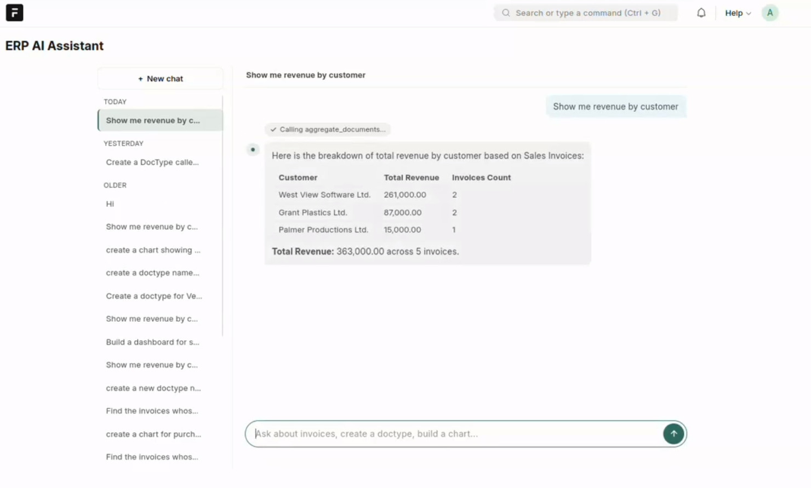
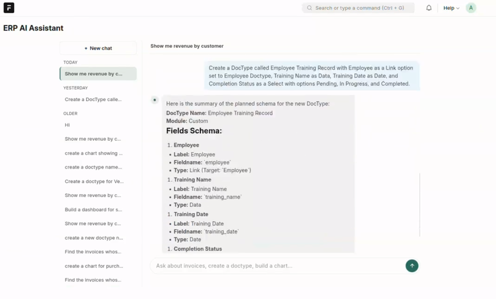
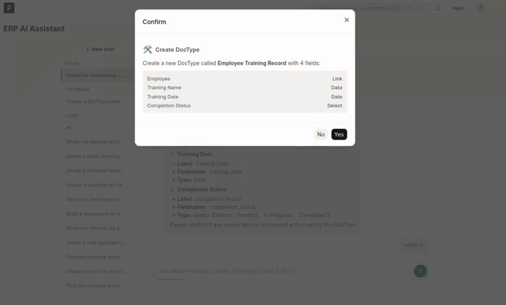
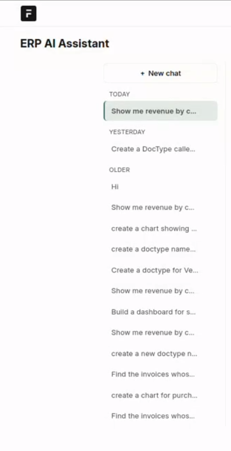
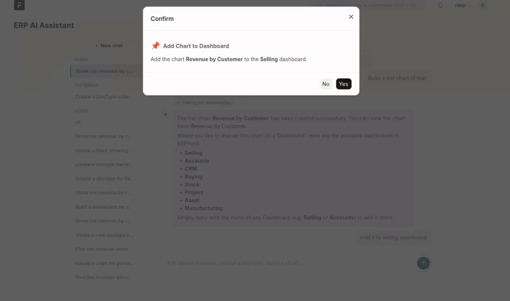
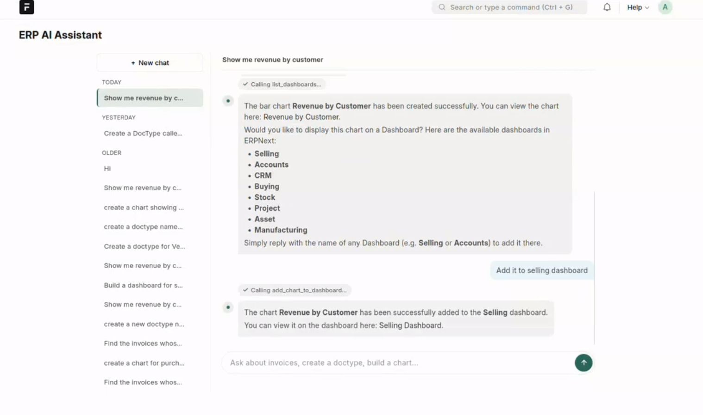
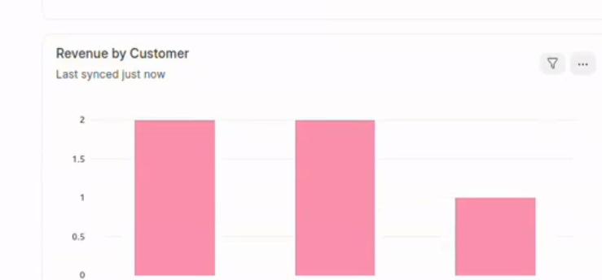
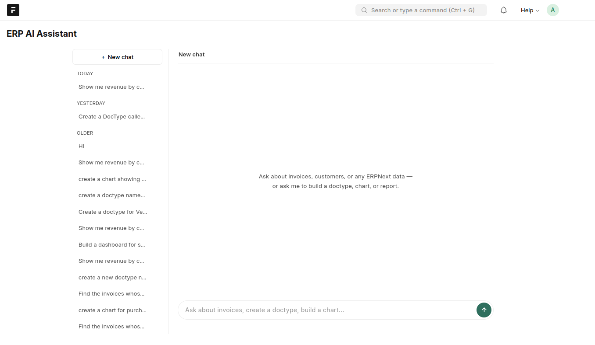
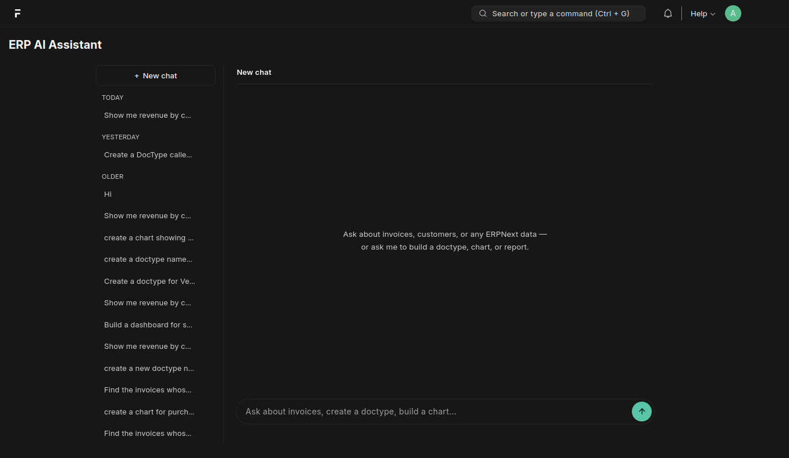
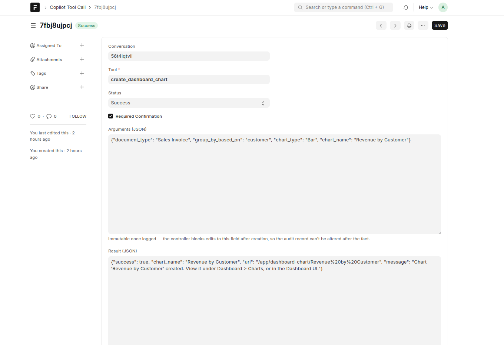

# ERPNext Copilot

> Ask your ERPNext site to do things, in plain English. A self-built Gemini-powered agent for ERPNext, running as a real installed Frappe app.



---

## What it does

Type things you would normally click through ERPNext's UI for:

- *"Show me sales invoices grouped by customer."*
- *"Create a doctype called Vehicle Maintenance Log with fields Vehicle, Date, Cost."*
- *"Build a bar chart of sales invoices by customer and add it to the Selling dashboard."*
- *"What is the total outstanding Sales Invoice amount and total Delivery Note value?"*
- *"Preview the file I just uploaded before I import it."*

Gemini decides which tool to call. Every tool runs as **your actual logged-in ERPNext user**, so permissions are enforced natively by Frappe — no shared API key, no permission bypass.

---

## Key features

**Permission-safe reads.** Every read uses `frappe.get_list()`, not `frappe.get_all()`. The difference matters: `frappe.get_all()` explicitly skips Frappe's row-level permission and match-condition filtering. An early version of this project used `get_all()` throughout and called itself "permission-respecting" — it wasn't. Every read was audited and fixed.

**Confirmation before every write.** Anything that changes data stops and shows a human-readable action card — not a raw JSON dump — before it runs. The card shows exactly what will be created, which fields, and where it will go.



**Permanent, tamper-resistant audit log.** Every write the agent proposes is logged to a `Copilot Tool Call` record the moment it's proposed — before the user even sees the confirm dialog. The controller blocks editing the tool name and arguments after creation, so the record can't be rewritten after the fact. Deleting a conversation from the sidebar does not erase the audit entries for what it did.

**Persistent conversation history.** A left sidebar lists past conversations, auto-titled from your first message, grouped by Today / Yesterday / Older. Switch between threads or start a new one without losing anything.



**Live streaming with tool-call status.** Replies stream word by word. A status chip appears the moment a tool is dispatched ("✓ Calling aggregate_documents...") so a multi-step request never looks frozen.

**Markdown rendering.** Agent replies render tables, bold text, and lists properly. The renderer is self-contained — no dependency on whether `frappe.markdown()` has GFM tables enabled.

**Gemini thinking-model support.** `gemini-3.6-flash` is a thinking model. Its internal reasoning (the "Wait, let's check..." monologue) is filtered from replies and never shown to the user or streamed to the browser.

---

## Screenshots

| | |
|---|---|
|  |  |
| *Revenue by customer — live ERPNext data in a real table* | *Human-readable confirm card before creating a chart* |

| | |
|---|---|
|  |  |
| *Success reply with a clickable link to the created object* | *The chart landed in ERPNext's Selling dashboard* |

| | |
|---|---|
|  |  |
| *Light mode* | *Dark mode — follows ERPNext's own theme toggle* |


*Every write is logged — who, what tool, what arguments, confirmed or cancelled*

---

## Quick start

```bash
# from your bench directory
bench get-app <this-repo-url>
bench --site your-site install-app erpnext_copilot
bench --site your-site migrate        # creates the conversation and audit-log tables

# get a free key from https://aistudio.google.com/apikey
bench --site your-site set-config gemini_api_key "your-key"
```

**Web chat UI:** visit `/app/copilot_chat` on your site.

**Console:**
```bash
bench --site your-site console
```
```python
from erpnext_copilot.custom_code.gemini_agent import run
run()
```

> **Note on rate limits.** The Gemini free tier allows 5 model calls per minute. A multi-step request (query → create chart → add to dashboard) can use 4–6 calls. If you hit the limit, the chat shows the exact wait time from Google's response rather than a generic error.

---

## Tools at a glance

| Category | Tools |
|---|---|
| Search & fetch | `search_documents`, `search_doctype`, `fetch`, `search` |
| Aggregation — single doctype | `aggregate_documents`, `list_invoices` |
| Aggregation — cross-doctype | `cross_doctype_summary` |
| Schema | `get_doctype_fields` |
| Files & import | `read_uploaded_file`, `clean_uploaded_file`, `import_data_to_doctype` |
| Reports | `find_reports`, `save_report` |
| Create *(confirmed before running)* | `create_doctype`, `create_dashboard_chart`, `add_chart_to_dashboard` |
| Dashboards | `list_dashboards` |

`aggregate_documents` and `search_documents` work against **any DocType** — they take a `doctype` parameter rather than being hardcoded per document type, and validate every field name against Frappe's real metadata before building a query.

`cross_doctype_summary` handles the one case `aggregate_documents` cannot: a summary where each row is a different doctype entirely (e.g. total outstanding Sales Invoice amount alongside total Delivery Note value in one answer). Report Builder is scoped to a single doctype, so this always answers live in chat and is never saved as a report.

---

## Architecture

```
User message (console or web chat)
        │
        ▼
Gemini — decides which tool to call, in a loop so a single
message like "show X, then create Y" can chain multiple calls
        │
        ├─ read tool ──► dispatched immediately
        │
        └─ write tool ─► logged to Copilot Tool Call (Awaiting Confirmation)
                          │
                          ▼
                    user confirms/cancels in the browser
                          │
                          ▼
        Tool dispatch → api.py (@frappe.whitelist() methods)
        │
        ▼
frappe.get_list() / frappe.get_doc() + check_permission()
        │   runs as the real logged-in user — row-level permissions
        │   enforced natively by Frappe, not by this app
        ▼
ERPNext database
```

Two front ends share the same tool layer: `gemini_agent.py` (console REPL) and `agent_api.py` (whitelisted HTTP endpoints for the web chat). The console REPL keeps history in memory; the web chat persists it, since HTTP has no equivalent persistent process.

**Persistence** — two custom DocTypes, scoped by Frappe's own `if_owner` permission:

- **Copilot Conversation** — one record per chat thread. Title, serialized Gemini history, last-message timestamp. The sidebar lists these; `ask_agent` loads and saves one on every turn.
- **Copilot Tool Call** — one record per write-tool invocation. Logged the moment the model proposes it (`Awaiting Confirmation`) and resolved once the user decides (`Success` / `Error` / `Cancelled`). Independent of conversation history. Controller blocks editing `tool_name` and `arguments` after creation.

**Streaming** — replies stream over Frappe's built-in realtime (Socket.IO) channel via `frappe.publish_realtime`. Gemini thinking-model parts (`thought=True`) are collected into history (required by some model versions) but never streamed to the browser.

**History trimming** — the full history is cached (Gemini 3.x requires `thought_signature` on function-call parts to survive round-trips), but only the last 8 genuine user turns are sent per model call. The trim cuts at real conversational turn boundaries, never in the middle of a tool-call chain — a fixed object-count slice was the original implementation and caused `400 INVALID_ARGUMENT` errors on multi-step requests.

**Error handling** — unexpected failures (tool errors, model errors) are logged to Frappe's Error Log at `/app/error-log` with a full traceback, and a short message naming the exception type is shown in the chat. Rate-limit errors (`429 RESOURCE_EXHAUSTED`) surface the exact retry-after delay from Google's response rather than a generic error, and are never retried immediately.

---

## Security notes

- `frappe.get_all()` is never used. Every read uses `frappe.get_list()` so Frappe's row-level permission and match-condition filtering applies.
- `frappe.get_doc()` is always followed by an explicit `check_permission("read")` call — `get_doc` alone checks nothing.
- No raw SQL is generated by the model. `aggregate_documents` builds a parameterised query in Python from validated field names; `cross_doctype_summary` uses `frappe.get_list()` with aggregate expressions. The model supplies field names and filter values, never query text.
- Write tools (`create_doctype`, `create_dashboard_chart`, `add_chart_to_dashboard`, `import_data_to_doctype`, `save_report`) require explicit user confirmation and are logged before execution.
- The audit log controller blocks post-creation edits to `tool_name` and `arguments` so the record cannot be altered after the fact.

---

## Known limitations

- **No update/submit/cancel/delete tools yet.** Every write tool only creates something new. Marking an invoice paid, submitting a Purchase Order, or reassigning a ticket still requires the regular ERPNext UI.
- `clean_uploaded_file` makes a separate blocking Gemini call on top of the main loop — not yet moved to a background job.


---

## License

MIT